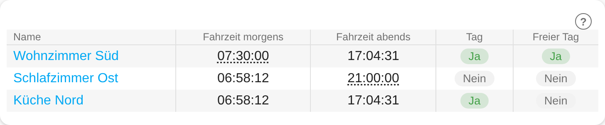
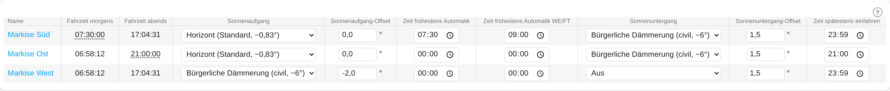
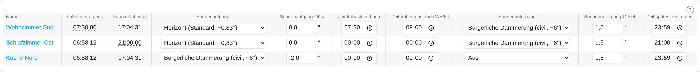

# Rollladen Zeiten

*English version: [README.en.md](README.en.md)*



Berechnet aus dem Sonnenstand **Tag/Nacht** sowie die **Fahrzeiten für Morgen und Abend**, berücksichtigt dabei **freie Tage** (Wochenende, Feiertage, Urlaub, Schichtdienst) und liefert alles als Entitäten für Automationen und die Integration **Rollladen Steuerung**.
Beliebig oft instanziierbar (Einstellungen → Geräte & Dienste → Integration hinzufügen → „Rollladen Zeiten“), z. B. je eine Instanz für Süd-, Ost- und Nordseite. Beim Anlegen werden nur Name, Gerätetyp, Wochenendtage und Kalender gewählt, **alle Einstellungen sind danach Entitäten des Geräts** (Dashboard-tauglich, bleiben nach Neustart erhalten). Standort und Zeitzone kommen aus den HA-Grundeinstellungen.

## Einrichtung (beim Anlegen der Instanz)

Nur der **Name** ist **Pflicht**. Alles andere ist **optional** bzw. hat eine Vorgabe und lässt sich später über „Konfigurieren“ ändern.

| Feld | Pflicht? | Hinweis |
|---|---|---|
| Name | **Pflicht** | Gerätename der Instanz (leer = „Rollladen Zeiten“) |
| Gerätetyp | Vorgabe *Rollo / Jalousie* | *Rollo / Jalousie* oder *Markise*. Ändert **nur die Bezeichnung** der drei Zeitgrenzen (siehe Einstellungen), nicht die Berechnung. Nachträglich über „Konfigurieren“ änderbar, die Entitäten bleiben dabei dieselben |
| Wochenendtage | Vorgabe Sa/So | Diese Wochentage gelten als freie Tage. Leere Auswahl = kein Wochenende |
| Kalender für freie Tage | optional | Beliebig viele `calendar`-Entitäten (Feiertage aus der HA-Integration „Feiertage“, Urlaub, Schichtkalender …). Ein Tag mit Termin gilt als frei |

## Einstellungen (Entitäten des Geräts)

Alle Werte sind Entitäten (Kategorie „Konfiguration“) und bleiben nach einem Neustart erhalten. Mit den Vorgaben gilt: Fahrzeit = Sonnenaufgang bzw. -untergang, keine Zeitgrenzen.

| Einstellung | Typ | Vorgabe | Wirkung |
|---|---|---|---|
| Sonnenaufgang / Sonnenuntergang | `select` | Horizont | Horizont (−0,83°, wie `sun.sun`), Bürgerlich (−6°), Nautisch (−12°), Astronomisch (−18°) oder **Aus**. Bei *Aus* ist der Sonnenstand abgeschaltet, es gelten nur die Zeitgrenzen (Offset wirkungslos) |
| Sonnenaufgang- / Sonnenuntergang-Offset | `number` (−30…30 °) | 0 ° | Wird zur Sonnenhöhe des Presets addiert. Positiv = Sonne höher → morgens später, abends früher |
| Zeit frühestens hoch<br>*(Markise: Zeit frühestens Automatik)* | `time` | 00:00 | Fahrzeit morgens = **später** von (Sonnenstand, diese Zeit). **00:00 = keine Übersteuerung** |
| Zeit frühestens hoch WE/FT<br>*(Markise: Zeit frühestens Automatik WE/FT)* | `time` | 00:00 | WE = Wochenende, FT = Freie Tage (Attribut `comment`). An freien Tagen **ersetzt** sie die normale früheste Zeit. **00:00 = die normale Grenze gilt auch an freien Tagen** |
| Zeit spätestens runter<br>*(Markise: Zeit spätestens einfahren)* | `time` | 23:59 | Fahrzeit abends = **früher** von (Sonnenstand, diese Zeit). **23:59 = keine Übersteuerung** |

Bei den Zeit-Reglern werden die Sekunden beim Setzen immer auf `00` gesetzt (Zeiten gelten auf die Minute genau).

## Logik

**Fahrzeit morgens** = später von *Sonnenaufgang* (mit Offset) und *Zeit frühestens hoch* (an freien Tagen *… WE/FT*, falls gesetzt).
**Fahrzeit abends** = früher von *Sonnenuntergang* (mit Offset) und *Zeit spätestens runter*.
**Tag** ist, wenn Fahrzeit morgens ≤ jetzt < Fahrzeit abends, sonst Nacht. Die Zeiten zeigen immer den **heutigen** Tag und springen um Mitternacht auf den neuen Tag; die Umschaltung erfolgt sekundengenau zum Zeitpunkt, es gibt kein zyklisches Abfragen der Sonne.

**Freie Tage**: Ein Tag gilt als „frei“, wenn er ein **Wochenendtag** ist oder in einem der gewählten **Kalender** einen Termin hat (ganztägig oder mit Uhrzeit, sobald er den heutigen Tag berührt). Für Schichtdienst eignet sich daher ein Kalender, der nur die freien Tage enthält. Kalender werden um Mitternacht, bei Änderungen der Kalender-Optionen und alle 30 Minuten geprüft (nicht bei jeder Änderung einer Einstellung). Ist ein Kalender (z. B. nach dem Start) noch nicht erreichbar, wird nach einer Minute erneut versucht; bis dahin gilt das letzte bekannte Ergebnis. Der Sensor **Freier Tag** nennt im Attribut `reasons` den Grund (`weekend` bzw. die Kalender-Entität).

**Sonderfälle**

* Sonnenstand *Aus*: Morgens beginnt der Tag um 00:00 bzw. bei der frühesten Zeit, abends endet er bei der spätesten Zeit bzw. um Mitternacht. Der Uhrzeit-Sensor zeigt dann `23:59:00`.
* Polartag (Sonne unterschreitet die Zielhöhe nicht): wirkt wie *Aus*, die Zeitgrenzen gelten weiterhin.
* Polarnacht (Sonne erreicht die Zielhöhe nie): Fahrzeiten sind `unknown`, Zustand ist Nacht.
* Liegt die Fahrzeit abends **vor** der Fahrzeit morgens (z. B. morgens 18:00, abends 05:00), reicht der Tag über Mitternacht: Tag ist dann ab der Morgenzeit bis 24:00 und von 00:00 bis zur Abendzeit. Die Sensoren zeigen weiterhin die beiden Zeiten des heutigen Kalendertags; das Attribut `spans_midnight` zeigt diesen Fall an. Bei Gleichheit beider Zeiten ist es durchgehend Nacht.

## Ausgaben (Entitäten)

| Entität | Typ | Inhalt |
|---|---|---|
| Tag | `binary_sensor` | an (Anzeige „Ja“) = Tag, sonst aus („Nein“); Attribut `spans_midnight` |
| Freier Tag | `binary_sensor` | an (Anzeige „Ja“) = Wochenende oder Termin in einem gewählten Kalender; Attribute `reasons`, `calendars_ok` |
| Tag/Nacht | `sensor` (enum) | `day` / `night` (Anzeige: Tag / Nacht); Attribute `polar`, `spans_midnight` |
| Fahrzeit morgens / abends | `sensor` | nur die Uhrzeit des heutigen Tages, z. B. `06:44:48` |
| Fahrzeit morgens / abends (Zeitstempel) | `sensor` (timestamp) | wie oben als vollständiger Zeitstempel; **standardmäßig deaktiviert**, für `trigger: time` mit `at: sensor.…` |

Attribute der Fahrzeit-Sensoren: `sun_time` (reiner Sonnenstand ohne Früh-/Spät-Grenze), `overridden` (Grenze greift), `timestamp`, `polar`.

## Zusammenspiel mit „Rollladen Steuerung“

In der Integration **Rollladen Steuerung** wählst du beim Anlegen eines Rollos als **Tag bzw. Tag/Nacht** den Sensor *Tag* (oder *Tag/Nacht*) einer Instanz und als **Fahrzeit morgens/abends** die beiden Fahrzeit-Sensoren (nur Anzeige in der Karte). Eine Instanz *Rollladen Zeiten* kann beliebig vielen Rollos dienen.

## Beispiel: Automation mit Zeitstempel-Sensor

```yaml
triggers:
  - trigger: time
    at: sensor.sued_fahrzeit_morgens_zeitstempel   # Entity-ID je nach Instanzname
actions:
  - action: cover.open_cover
    target:
      entity_id: cover.rollladen_sued
```

Alternativ ohne Zeitstempel-Sensor mit dem Uhrzeit-Sensor:

```yaml
triggers:
  - trigger: template
    value_template: "{{ now().strftime('%H:%M:%S') == states('sensor.sued_fahrzeit_morgens') }}"
```

## Lovelace-Karte „Rollladen Zeiten“


Tabelle mit einer Zeile je Instanz. Die Karte wird von der Integration selbst ins Frontend geladen (kein Eintrag unter Ressourcen nötig; nach einem Update Browser-Cache leeren, Strg+F5). Hinzufügen: Dashboard bearbeiten → Karte hinzufügen → **Rollladen Zeiten**; im Editor Geräte (Reihenfolge = Zeilenreihenfolge) und Spalten wählen. Die Spalten sind durch Striche getrennt.

**Was der Screenshot zeigt:**

| Zeile / Element | Zeigt |
|---|---|
| Name | Gerätename, ein Klick öffnet die Geräteseite |
| *Fahrzeit morgens / abends* | Uhrzeit des heutigen Tages. **Gepunktet unterstrichen** = eine Zeitgrenze greift (Wohnzimmer Süd morgens, Schlafzimmer Ost abends); der Tooltip nennt den reinen Sonnenstand |
| *Tag* | Chip **Ja** (grün) = Tag, **Nein** (grau) = Nacht (Schlafzimmer Ost) |
| *Freier Tag* | Chip **Ja** = Wochenende/Termin im Kalender (Wohnzimmer Süd) |
| „–“ | Wert nicht verfügbar |

Mit der Option **Art der Geräte** (Karteneditor: *Rollos / Jalousien* oder *Markisen*; YAML `device_type: shutter | awning`) wechselt die Beschriftung der Zeitgrenzen-Spalten. Für Rollos und Markisen legst du am besten je eine eigene Karte an:



Standardspalten sind *Fahrzeit morgens*, *Fahrzeit abends*, *Tag* und *Freier Tag*. Optional lassen sich die **Einstellungen** als weitere Spalten einblenden (Sonnenaufgang/-untergang, Offsets, die drei Zeitgrenzen). Mit `editable: true` sind sie direkt in der Karte änderbar:



```yaml
type: custom:rollladen-zeiten-card
title: Rollläden
devices:                     # Geräte-IDs (am einfachsten über den Karteneditor wählen)
  - 0123456789abcdef0123456789abcdef
columns:                     # Reihenfolge ist fest, hier nur die Auswahl
  - morning
  - evening
  - is_day
  - free_day
  # - morning_preset, morning_offset, earliest_morning, earliest_morning_free
  # - evening_preset, evening_offset, latest_evening
device_type: shutter         # shutter = Rollos/Jalousien, awning = Markisen (nur Beschriftung der Zeitgrenzen)
show_seconds: true           # false = nur HH:MM
editable: true               # false = Einstellungsspalten nur anzeigen
show_help: true              # Symbol ? mit Link zu dieser Dokumentation
```

## Installation

### Über HACS (empfohlen)

1. HACS öffnen → Menü (⋮) → **Benutzerdefinierte Repositories**.
2. Repository `https://github.com/Reinhard-M/ha-rollladen-zeiten` eintragen, Kategorie **Integration**, hinzufügen.
3. „Rollladen Zeiten“ in HACS suchen, **Herunterladen**, Home Assistant **neu starten**.
4. Einstellungen → Geräte & Dienste → Integration hinzufügen → „Rollladen Zeiten“.

### Manuell

Ordner `custom_components/rollladen_zeiten` aus diesem Repository nach `/config/custom_components/` kopieren, Home Assistant **neu starten**. Die Integration ist als Dienst (`integration_type: service`) deklariert und erscheint unter **Einstellungen → Geräte & Dienste → Integrationen** als eine Karte „Rollladen Zeiten“ mit allen Instanzen; jede Instanz ist ein Gerät mit allen Entitäten.

## Hilfe

In der Lovelace-Karte führt das Symbol **?** (Kreis mit Fragezeichen) und in den Einstellungsdialogen der Link *Dokumentation (README)* zu dieser Seite. Die Anzeige des Symbols in der Karte lässt sich im Karteneditor abschalten (`show_help: false`). Fehler und Wünsche bitte als [Issue](https://github.com/Reinhard-M/ha-rollladen-zeiten/issues) melden.

## Haftungsausschluss

* Dies ist ein **privates Hobbyprojekt** und eine **inoffizielle Community-Integration**. Sie steht in keiner Verbindung zu Home Assistant, Open Home Foundation, Nabu Casa, eQ-3/Homematic IP, Jarolift, Somfy oder anderen genannten Herstellern; alle Namen und Marken gehören ihren jeweiligen Inhabern und dienen nur der Beschreibung der Kompatibilität.
* Die Software wird **„wie besehen“ ohne jede Gewährleistung** bereitgestellt (siehe [LICENSE](LICENSE)). Die Nutzung erfolgt auf eigene Verantwortung.
* Sie ist **keine Sicherheitseinrichtung**. Sie ersetzt weder Wind-, Regen- oder Frostwächter noch Einklemmschutz oder Hinderniserkennung der Antriebe. Bewegte Rollläden, Jalousien, Markisen und Türen können Personen und Sachen gefährden; die Automatik fährt ohne Anwesenheitserkennung.
* Teste neue Einstellungen zunächst bei Anwesenheit und mache vor Updates ein Backup.

## Lizenz

[MIT-Lizenz](LICENSE) © 2026 Reinhard-M
